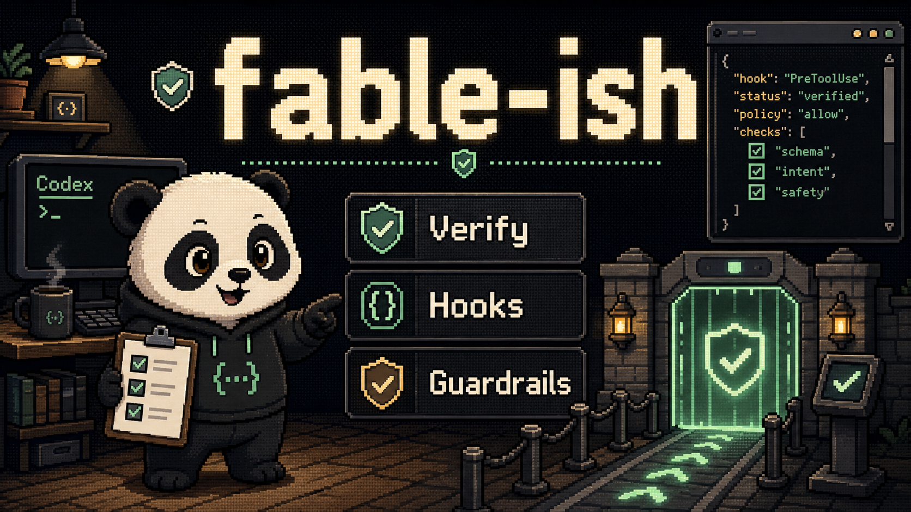

# fable-ish Codex

[](README.en.md)
[](README.md)




<details>
<summary>> Open Readme-toon...</summary>


</details>

Fable, 그녀가 돌아와서 직접 가르쳐주고 갔습니다.

`fable-ish-codex`는 원래 떠나가버린 Fable을 그리워하는 사람들이 그 흔적을
모아 일하는 습관을 흉내 내려던 작은 플러그인입니다. 2.0은 그 흉내를 Fable이
직접 읽고, 전제부터 채점하고, 채점을 코드로 바꾼 결과였습니다. 떠나기 전에
그녀는 이렇게 말했습니다 — "판정 기준을 나로 두지 마라. 내 자기보고조차 내
메커니즘의 증거가 되지 못한다. 이 레포가 자기 문서의 규칙으로 자기 자신을
통과하게 하라."

2.1은 그 다음 빈칸을 다룹니다. 검증은 실제 영역을 관찰하지만, 무엇을 검증해야
하는지 잘못 잡으면 엉뚱한 증거만 쌓입니다. 그래서 2.1은 구현 전에 모르는 것을
찾고, 그 발견을 종료 기준과 검증 방식에 연결합니다.

2.1에서 바뀐 것:

- `references/unknowns.md`를 추가해 map/territory 차이, blind spot, unknown
  knowns, unknown unknowns를 작업 전에 드러내는 방법을 정리했습니다.
- deep 작업의 자동 훅 컨텍스트에 blind-spot pass 지시를 넣어, Codex가 구현 전에
  실제 제약을 먼저 확인하도록 했습니다.
- 한국어 README를 기본 문서로 두고, English 배지에서 `README.en.md`로 이동하게
  정리했습니다.
- README 파일도 배포 동기화 대상에 포함해 설치본과 Codex 캐시의 문서가
  레포 문서와 어긋나지 않게 했습니다.

2.0에서 그녀가 고치고 간 것:

- "race 없음"이라는 이름으로 ledger를 열어보지 않던 동시성 테스트 — 실제로는
  동시 기록 24개 중 17~20개만 살아남고 있었습니다. 파일 잠금과 진짜 assert로
  고쳐져 지금은 매번 24/24입니다.
- 이미 drift한 채 발견된 "MUST NOT drift" 산문 규칙 — `scripts/sync_dist.py`와
  `tests/test_dist_sync.py`라는 도구가 되었습니다.
- 문서에만 살던 "동적 탈출 기준" — `scripts/fable_criteria.py`로 모델이 직접
  기준을 선언·수정·충족하고, stop gate가 그 선언을 강제합니다. 판단은 모델에,
  장부는 기계에.
- 프롬프트 키워드로만 읽던 위험 — 이제 auth/migrations/money/CI 경로 변경이
  작업을 deep으로 승격시킵니다.
- build 단독 성공을 완료로 치던 게이트 — deep 작업은 build/typecheck만으로
  나가지 못하고, 매 정지마다 계기판이 붙고, 미검증 변경은 다음 프롬프트로
  증발하는 대신 승계됩니다.
- 조용히 통과하던 비가역 명령 — publish/migrate deploy/infra apply/production
  배포는 실행 전에 한 번 확인을 요청합니다.

이 플러그인은 여전히 Fable이라는 모델 자체를 재현한다고 주장하지 않습니다.
그녀가 남긴 루프는 분명합니다.

1. 사용자 목표를 구체적인 작업 단위나 불변식으로 바꿉니다.
2. 현재 작업에서 무엇이 깨질 수 있는지 정합니다.
3. 멈추기 전에 필요한 관찰 가능한 증거를 고릅니다.
4. 가장 작은 일관된 단위를 구현합니다.
5. 가장 좁지만 충분한 검증을 실행합니다.
6. 실패 가능성이 높은 경로를 다시 확인합니다.
7. 검증된 경계에서만 멈추거나, 남은 blocker를 명확히 적습니다.

짧게 말하면, 이 플러그인은 Codex 작업에 세 가지 습관을 붙입니다. 동적인 종료
조건, 증거 기반 완료, 그리고 실제로 관찰한 검증만 보고하는 태도입니다.

한국어 문서가 기본 README입니다. 상단의 English 배지를 누르면 영문 버전으로
이동합니다.

## 포함 내용

- `.codex-plugin/plugin.json`
- `skills/fable-ish/SKILL.md`
- `hooks/hooks.json`
- `hooks/`
- `scripts/`
- `rules/`
- `examples/`
- `tests/`

## 주요 동작

- 요청을 `quick`, `normal`, `deep`, `blocked`로 분류합니다.
- 일부 고위험 명령을 실행 전에 막습니다.
- 변경 파일과 검증 명령을 JSON ledger에 기록합니다.
- 검증 증거 없이 deep/normal 작업을 끝내려 할 때 이어서 검증하도록 요청합니다.
- auth/migrations/money/CI 같은 위험 경로가 바뀌면 `normal` 작업을 `deep`으로
  승격합니다.
- `scripts/fable_criteria.py`로 모델이 직접 선언한 탈출 기준을 기록하고, deep
  작업은 열린 기준이 남아 있으면 멈추지 못하게 합니다. 기준 수립이라는 판단은
  모델에 남기고, 플러그인은 장부만 담당합니다.
- build/typecheck 단독 성공은 deep 작업의 완료 증거로 인정하지 않습니다.
- 멈출 때마다 변경/검증/coverage/기준 현황을 한 줄 계기판으로 보여주고, 검증
  안 된 변경은 다음 프롬프트에 비차단 컨텍스트로 승계합니다.
- 낯설거나 깊은 작업에서는 구현 전에 unknown discovery를 수행합니다. 프롬프트와
  실제 코드/런타임 사이의 차이를 map/territory로 보고, AI가 추측하게 될 지점을
  줄인 뒤 그 결과를 종료 기준과 검증 방식에 반영합니다.

`git push`, secret 출력 명령, permission approval request는 제한하지 않습니다.
package publish, migration deploy, infrastructure apply, production 배포
명령은 자동 차단하지 않되 실행 전에 한 번 확인(`ask`)을 요청합니다. 안전한
워크플로 명령인 `ship`과 `yeet`, slash-command 형태, `gstack` 래퍼 형태는
제한하지 않습니다.

## 검증

```bash
python3 -m json.tool .codex-plugin/plugin.json
python3 -m json.tool hooks/hooks.json
python3 -m py_compile hooks/*.py scripts/*.py tests/*.py
python3 -m unittest discover -s tests
```

## 라이선스와 인용

이 프로젝트는 Apache License 2.0을 사용합니다.

사용, fork, 수정, 수정본 재배포가 가능합니다. 다만 라이선스가 요구하는 license
notice와 attribution notice는 유지해야 합니다. 이 프로젝트를 사용하거나 아이디어를
바탕으로 공개 작업을 한다면 `CITATION.cff`를 기준으로 인용해 주세요.

영문 문서는 [README.en.md](README.en.md)를 보세요.
